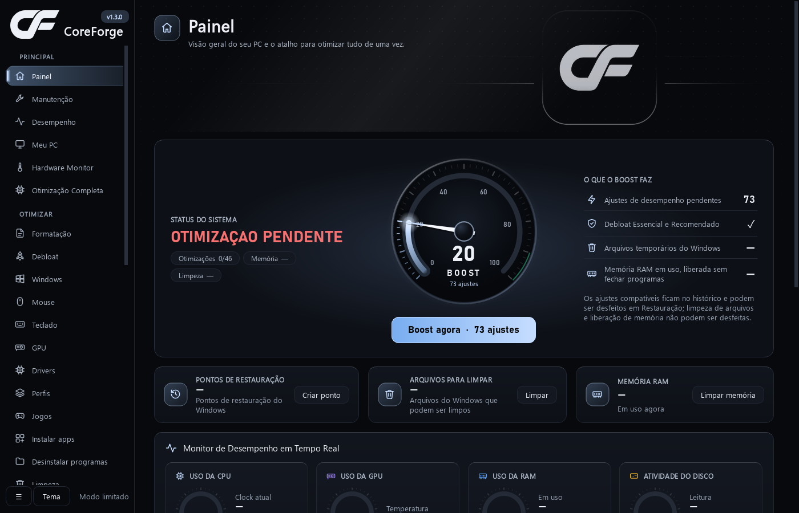
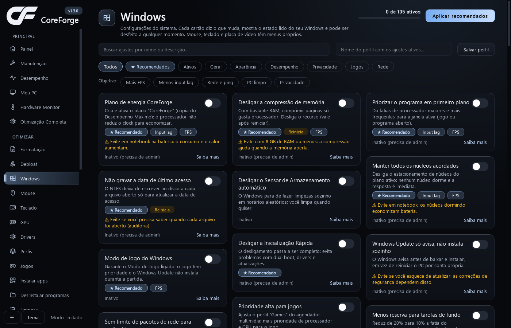
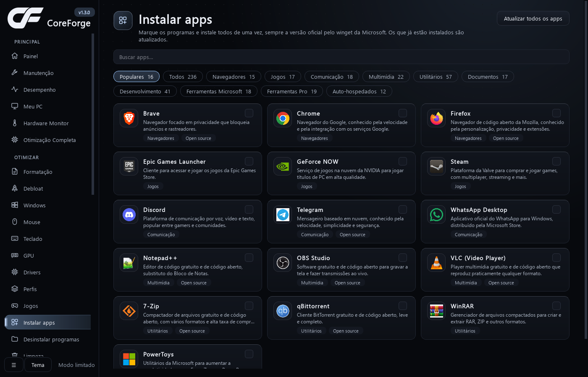
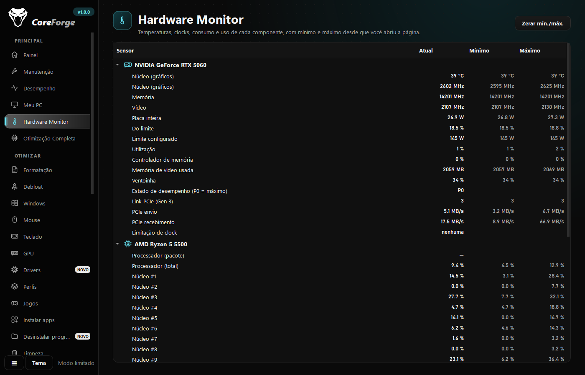
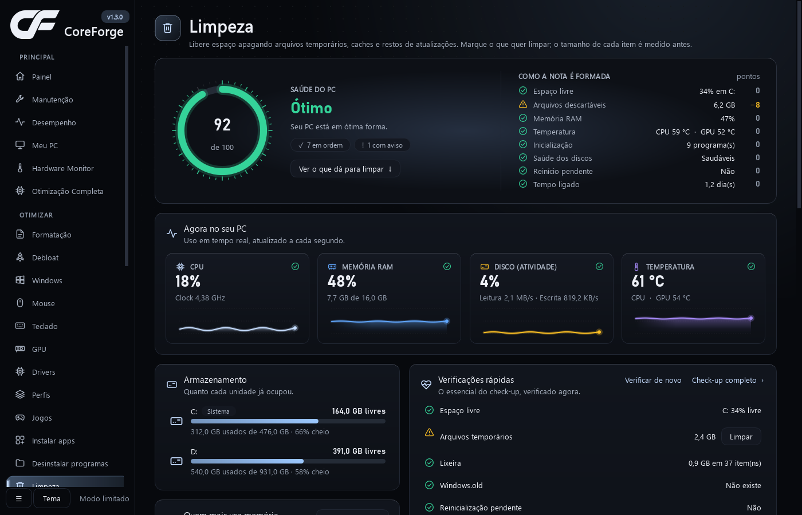

<p align="center">
  
</p>

<h1 align="center">CoreForge</h1>

<p align="center">
  <b>Otimize, limpe e turbine o Windows em um só lugar, com total controle e tudo reversível. Grátis.</b>
</p>

<p align="center">
  <a href="https://github.com/samuelperdigao/CoreForge-showcase/releases/latest"></a>
  
  
  
</p>

<p align="center">
  <a href="https://github.com/samuelperdigao/CoreForge-showcase/releases/latest"><b>⬇️ Baixar a última versão</b></a>
  &nbsp;|&nbsp;
  <a href="https://www.coreforge.dev.br"><b>Site do CoreForge</b></a>
</p>

<p align="center">
  
</p>

---

## Como instalar

1. Baixe o `CoreForge-x.y.z.zip` na página de [releases](https://github.com/samuelperdigao/CoreForge-showcase/releases/latest).
2. Extraia o zip numa pasta (por exemplo, `C:\CoreForge`). Não rode de dentro do zip.
3. Abra `CoreForge.exe` e aceite o pedido de administrador.
4. Se o Windows SmartScreen aparecer, clique em **Mais informações** e depois em **Executar assim mesmo**. Isso acontece porque o executável ainda não tem assinatura digital.

Para conferir o arquivo, compare o SHA-256 do zip com o `SHA256SUMS.txt` da release:

```powershell
Get-FileHash .\CoreForge-1.1.0.zip -Algorithm SHA256
```

## Destaques

<table>
  <tr>
    <td align="center" width="25%"><h2>35</h2>ferramentas no menu</td>
    <td align="center" width="25%"><h2>170</h2>ajustes do Windows</td>
    <td align="center" width="25%"><h2>236</h2>apps para instalar</td>
    <td align="center" width="25%"><h2>3</h2>idiomas (PT, EN, ES)</td>
  </tr>
</table>

- **Boost com um clique.** Uma pontuação de otimização mostra o estado do PC, e o botão **Boost** aplica os ajustes pendentes, limpa temporários e libera memória.
- **Nada é definitivo.** Cada alteração entra no histórico e pode ser desfeita, e os pontos de restauração do Windows ficam a um clique.
- **Transparente.** Cada ajuste diz o que muda, quando evitar (ex.: notebook na bateria) e mostra o estado real lido do Windows.
- **Feito para jogos.** Boost no processo real do jogo, overlay, medição de FPS via ETW e relatório de cada sessão.

## Recursos

| | Área | O que tem |
| :---: | --- | --- |
| 🎮 | **Jogos** | Biblioteca (Steam, Epic e jogos adicionados), *Jogar com Boost*, overlay, FPS via ETW, relatórios de sessão e gravação de clipes |
| ⚙️ | **Otimização** | Ajustes de Windows, mouse, teclado e GPU, Otimização Completa, debloat, plano de energia próprio e perfis salvos |
| 🧹 | **Limpeza** | Temporários, caches (Windows Update, shaders, navegadores), espaço em disco, inicialização e desinstalador completo |
| 📦 | **Apps** | Instalação e atualização em lote pelo **winget**, sempre com a versão oficial |
| 🩺 | **Diagnóstico** | Check-up, Meu PC, Hardware Monitor (temperaturas, clocks, consumo), detector de travadas (DPC), teste de estabilidade, comparação de placas de vídeo |
| 🌐 | **Rede** | DNS mais rápido, teste de velocidade e perda de pacotes |
| 🛡️ | **Segurança** | Reparos do Windows, Defender, pontos de restauração, backup e manutenção semanal agendada |
| 🖱️ | **Testes** | Teste do mouse e teste do monitor |

## Galeria

<table>
  <tr>
    <td width="50%"><p align="center"><b>Ajustes do Windows</b>: filtros por objetivo e estado real de cada item</p></td>
    <td width="50%"><p align="center"><b>Instalar apps</b>: 236 programas oficiais via winget</p></td>
  </tr>
  <tr>
    <td width="50%"><p align="center"><b>Hardware Monitor</b>: sensores com mínimo e máximo</p></td>
    <td width="50%"><p align="center"><b>Limpeza</b>: tamanho medido antes de apagar</p></td>
  </tr>
</table>

## Decisões de projeto

- **Reversibilidade primeiro:** toda alteração é registrada em histórico com desfazer, e há modo simulação para ver o que seria feito antes de aplicar.
- **Estado real, não presumido:** a interface lê o estado atual do Windows (registro, serviços, planos de energia) em vez de assumir o padrão.
- **Medir antes de apagar:** a limpeza calcula o tamanho de cada item antes de qualquer remoção.
- **Fontes oficiais:** apps instalados e atualizados via winget, sem instaladores de terceiros.
- **Modo limitado sem administrador:** sem elevação, o app abre e mostra tudo que não exige privilégio.
- **Testes e CI:** testes automatizados com chave de registro descartável e lint rodando no Windows a cada push.

## Stack

Python 3.12, PySide6 (Qt 6), psutil, pywin32, numpy, winget, ETW (medição de FPS), PyInstaller, pytest, ruff e GitHub Actions.

## Requisitos

- Windows 10 ou 11 (64 bits)
- Permissão de administrador para ajustes, limpeza do sistema, reparos e medição de FPS. Sem ela, abre em **modo limitado**.

## Contato

Sugestões, bugs ou conversa sobre o projeto: abra uma [issue](https://github.com/samuelperdigao/CoreForge-showcase/issues) ou fale comigo pelo meu perfil, [github.com/samuelperdigao](https://github.com/samuelperdigao).

## Licença

O CoreForge é **gratuito** para uso pessoal e comercial. O código-fonte não é público. Veja os termos em [LICENSE](LICENSE).
